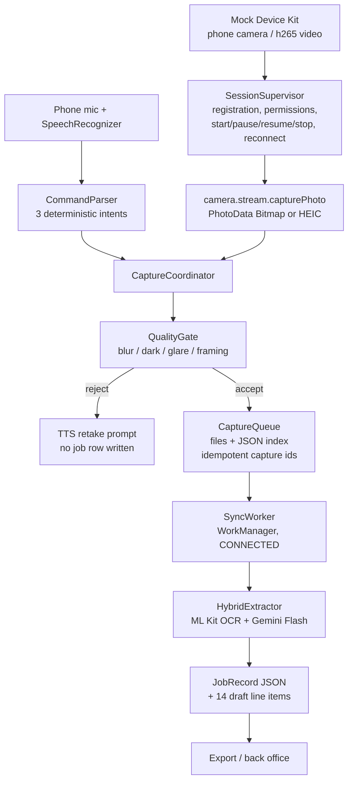

# FieldCapture — hands-free field capture on DAT 1.0

An Android app that turns a spoken walk-through into a structured job record and draft
estimate line items. Glasses are simulated with **Meta Wearables Mock Device Kit** fed
from the phone camera, so no hardware is required.

> Status: scaffolded and documented. Accuracy numbers, demo video and the three sample
> job records are **not** included: they must come from your own captures. See
> [`docs/EVAL_REPORT.md`](docs/EVAL_REPORT.md) and [`samples/README.md`](samples/README.md).
> No numbers or frames are fabricated.

## Setup (clean machine, under 10 minutes)

1. Install **Android Studio Flamingo+** with SDK Platform 36 and JDK 17. No Mac needed.
2. Clone this repo and open it as an Android project. Gradle sync fetches DAT 1.1.0 from Maven Central — no token required.
3. `Copy-Item local.properties.example local.properties` (or `cp` on macOS/Linux). For Mock Device Kit the two `mwdat_*` values stay `0`.
4. Optional: add a `gemini_api_key` to `local.properties` for damage/note extraction. Without it the app still captures, gates quality, queues offline and runs nameplate OCR. A model can be chosen with `gemini_model`.
5. Run on an Android 10+ phone with camera and mic. Tap through the UI in order:

   | Button | What it does |
   |---|---|
   | 1 Enable MDK | Simulates registration + permissions |
   | 2 Pair | Pairs a simulated Ray-Ban Meta |
   | 3 Power/Don/Unfold | Makes the mock device streamable; also restores after a drop |
   | 4 Feed: phone cam | Uses the handset back camera as the glasses feed |
   | Start walk | Creates the DAT session, starts the stream and the phone mic |
   | Simulate drop | doff + fold + power off; the supervisor reconnects |
   | Offline: ON | Forces the queue to hold captures locally |
   | Export jobs | Copies job JSON to `Android/data/com.fieldcapture.app/files/exports` |

6. Then, hands free: `capture nameplate`, `capture damage, kitchen, north wall`,
   `note: subfloor soft by the cabinet`. A failed quality check speaks a retake prompt.
   `Stop walk` writes the job record.

CLI build: `./gradlew assembleDebug`, `./gradlew test`, `./gradlew installDebug`,
`./gradlew connectedAndroidTest` (on a device).

Verified here with JDK 17.0.21 and Android SDK 36: `assembleDebug`, `test` (7 passing)
and `compileDebugAndroidTestKotlin` all succeed. `connectedAndroidTest` needs a device.

Video-file feeds must be **h.265/HEVC** on Android:

```bash
ffmpeg -i input.mp4 -c:v libx265 -tag:v hvc1 -an -vf "scale=540:960" output.mp4
```

## Architecture



State ownership:

- `SessionSupervisor` owns the DAT `DeviceSession`, `Camera`, `Stream` and all reconnect
  logic. It attaches a capability **only** after `DeviceSessionState.STARTED`, never twice
  across a `PAUSED → STARTED` resume, and creates a fresh session after terminal
  `STOPPED`. `session.errors` is observed because `start()` returns `Unit`.
- `CaptureCoordinator` serialises captures with a mutex: only one
  `stream.capturePhoto()` can be in flight (the SDK rejects concurrent calls).
- `CaptureQueue` writes the image before the index row; capture UUIDs are idempotency
  keys, so a retry after a disconnect cannot duplicate a line item.
- `SyncWorker` runs under a `NetworkType.CONNECTED` constraint; the app's offline toggle
  forces `retry()` while keeping every capture on disk.

## What was decided and why

| Decision | Reason |
|---|---|
| Android, Kotlin 2.2, DAT 1.1.0 | DAT iOS needs Xcode 26.4 on a Mac; this workflow is Windows. The brief says DAT 1.0, the published sample pins 1.1.0 — version is in `gradle/libs.versions.toml`. |
| Phone mic for voice | DAT Speech / Voice Invocations / Audio Streaming are experimental and capability-gated; MockDeviceKit explicitly does not emit deterministic PCM. One tap arms continuous recognition; after that the tech never touches the phone. |
| Deterministic grammar, not an LLM | Fixed intents are faster, free and testable. New commands (live-change drill) are one `when` branch in `CommandParser` plus one field mapping. |
| On-device OCR for nameplates | Works with no signal; ML Kit supplies real per-word confidence. Regex parses make/model/serial/date. |
| Gemini Flash for damage and notes | Needs image semantics. `temperature=0`, `responseMimeType=application/json`, strict schema. Model and token counts are recorded in each job record's `diagnostics` and in logs. |
| Draft-only line items | Quantity is an estimate without depth; every item is marked `DRAFT` with a basis and confidence. |
| No Room/Compose | Fewer moving parts while the SDK lifecycle is being proven; the queue is a small atomic JSON index. |

## Quality thresholds

Current values are **seed values**, not measured results: see `QualityTuning` in
`app/src/main/java/com/fieldcapture/app/quality/QualityGate.kt`. Replace them with the
output of `tools/eval/thresholds.py` on your labelled frames before submitting. Metrics
are computed on a fixed 256 px working image so Laplacian variance is comparable across
captures.

## Stretch goal chosen

**Size without depth.** `damage.size_sq_ft_estimate` is produced from visible reference
objects by the VLM and deliberately given low confidence. The eval report should compare
it against tape measurements and report mean absolute percentage error. The other
stretch goals were cut deliberately to keep the core loop solid.

## Known limitations (flag these, don't hide them)

- Mock Device Kit cannot simulate real Bluetooth degradation, glasses thermals/battery,
  true stereo geometry, or deterministic microphone audio. Real glasses will change the
  voice path and the stream's visual quality.
- Video feeds must be h.265 on Android; phone-camera feeds require the *host* camera
  permission, which is separate from DAT's `Permission.CAMERA`.
- A single cap-touch tap pauses the stream and it may resume by itself; the supervisor
  waits rather than forcing a restart.
- GPS/room context is not inferred; room and surface come from speech or the image.
- Gemini confidence is not calibrated out of the box; `tools/eval/evaluate.py` produces
  the calibration table that should drive a mapping before submission.
- No server is included. "Back office" is the exported job JSON directory, which is
  enough to verify the loop but not a production upload endpoint.

## Tools used

Built with **OpenCode (Big Pickle)** as the coding agent. Meta's published
[`AGENTS.md`](https://github.com/meta/meta-wearables-dat-android/blob/main/AGENTS.md)
was read directly (the agent's plugin would not load mid-session), and DAT API symbols
were checked against `wearables.developer.meta.com/llms.txt` and the 1.1 Android API
reference. ML Kit API details came from Google's Android reference. No off-the-shelf
inspection product was used.

## With two more weeks

1. Replace seed thresholds with calibrated cutoffs and add a per-condition retake policy.
2. Run five techs through real glasses in week one; instrument session drops and retake rates.
3. Multi-frame super-resolution / temporal denoise for walking-camera captures; estimate
   area from tracked homography with a printed reference card instead of a single VLM guess.
4. Add the fourth voice command via a typed intent registry, plus an on-device wake word so
   the initial mic tap disappears.
5. Add a real back-office endpoint with signature-verified idempotency and per-job cost logging.
